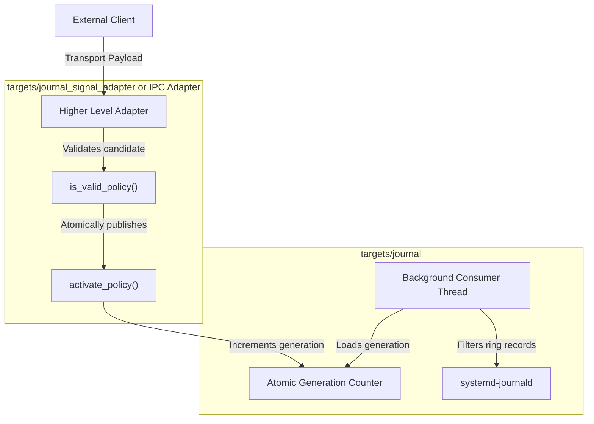

[Return to Journal developer guide](journal_developer_guide.md)

# Journal runtime policy technical reference

This document explains the runtime log policy engine in `targets/journal`. It covers physical component boundaries, the complete struct definitions, and two adapter patterns.

## Architectural overview and physical levelization

The `journal` target sits at the base of the project physical dependency graph. It links zero networking, serialization, or IPC libraries. Runtime policy administration is handled by higher level adapter components in `targets/`.



The `journal` target implements a strict last caller wins contract. It tracks no sessions and performs no authentication. The most recent valid call to `journal::activate_policy` updates consumer behavior immediately.

## Pointer free policy and component override reference

The policy API relies on two plain data structures defined in `targets/journal/journal/journal.hpp`.

```cpp title="targets/journal/journal/journal.hpp"
// Value based per component override of the debug stride. An empty component name marks an unused slot.
// The fixed size character array keeps the struct free of pointers so an external control component
// can fill it directly from a Varlink, D-Bus or HTTP payload without dangling references.
struct component_override {
    std::array<char, k_policy_component_capacity> component{};
    std::uint32_t debug_stride{1U};

    [[nodiscard]] friend constexpr auto operator==(
        const component_override&,
        const component_override&
    ) noexcept -> bool = default;
};

// Declarative consumer policy. A default constructed policy is the compiled in flight recorder default.
// Strides use 0 for ring only, 1 for always emit and N for every Nth record of that severity.
// Records at or above the lookbehind trigger severity always emit and flush the recent history first.
struct policy {
    std::array<std::uint32_t, k_severity_count> stride_by_level{1U, 1U, 1U, 1U, 1U, 1U, 1U, 0U};

    // When ring backlog exceeds this percentage notice and info records are thinned out.
    std::uint8_t congestion_threshold_pct{k_default_congestion_threshold_pct};
    std::uint32_t congestion_info_stride{k_default_congestion_info_stride};

    severity lookbehind_trigger{severity::error};
    std::uint16_t lookbehind_slots{k_default_lookbehind_slots};

    std::array<component_override, k_policy_override_count> overrides{};

    [[nodiscard]] friend constexpr auto operator==(const policy&, const policy&) noexcept -> bool = default;
};
```

* **Fixed size character storage.** The `component_override` struct stores subsystem names in `std::array<char, 32>` rather than dynamic pointers. This layout allows an adapter to populate candidate structs directly from network buffers without heap allocations.
* **Severity strides.** The `stride_by_level` array controls output rates across all eight Syslog levels. Setting a stride to `0` retains records exclusively inside the flight recorder ring buffer. Setting a stride to `1` emits every record. Any positive integer `N` emits every Nth record of that severity.
* **Congestion throttling.** The `congestion_threshold_pct` and `congestion_info_stride` parameters provide automated backoff. When ring buffer backlog crosses this threshold, the consumer thins `notice` and `info` records using the configured congestion stride.
* **Lookbehind window.** The `lookbehind_trigger` and `lookbehind_slots` fields govern fault breadcrumb flushes. When an event at or above the trigger level occurs, recent skipped records flush to the journal ahead of the fault record.
* **Per component microscope overrides.** The `overrides` array contains four slots populated via `journal::make_component_override`. This mechanism enables full debug stream capture for isolated subsystems without flooding the journal.

## Public validation, activation, and telemetry functions

Higher level adapter components control and inspect logging through five public functions.

```cpp title="targets/journal/journal/journal.hpp public control surface"
[[nodiscard]] constexpr auto is_valid_policy(const policy& candidate) noexcept -> bool;
[[nodiscard]] auto activate_policy(const policy& candidate) noexcept -> bool;
void reset_default_policy() noexcept;
[[nodiscard]] auto active_policy() noexcept -> policy;
[[nodiscard]] auto statistics_snapshot() noexcept -> statistics;
```

* **Pre activation validation.** Call `journal::is_valid_policy` before applying untrusted external data. The validator verifies stride ceilings, percentage limits and severity values. It also checks ring capacities and printable component names.
* **Atomic swapping and default reset.** Call `journal::activate_policy` to publish a validated candidate struct. The consumer thread observes the new configuration on its next pass through an atomic generation counter. Call `journal::reset_default_policy` to restore flight recorder defaults.
* **Live state queries and telemetry.** Call `journal::active_policy` to inspect the active configuration. Call `journal::statistics_snapshot` to inspect cumulative `submitted`, `emitted` and `lost` record counters for system health monitoring.

## Zero dependency POSIX signal adapter component

Signals represent a lightweight control mechanism requiring zero third party libraries. The exact same `journal` calls work inside Varlink, D-Bus, or HTTP REST adapters.

The physical component `targets/journal_signal_adapter` exemplifies this pattern. It links `PRIVATE ${PROJECT_NAME}::journal` and manages a dedicated listener thread.

```cpp title="targets/journal_signal_adapter/journal_signal_adapter/journal_signal_adapter.hpp"
class signal_adapter {
public:
    [[nodiscard]] static auto default_debug_policy() noexcept -> journal::policy;

    [[nodiscard]] static auto create(
        journal::policy debug_policy = default_debug_policy()
    ) noexcept -> std::optional<signal_adapter>;

    explicit signal_adapter(journal::policy debug_policy = default_debug_policy());
    ~signal_adapter() noexcept;

    signal_adapter(const signal_adapter&) = delete;
    auto operator=(const signal_adapter&) -> signal_adapter& = delete;
    signal_adapter(signal_adapter&& other) noexcept;
    auto operator=(signal_adapter&& other) noexcept -> signal_adapter&;

    [[nodiscard]] auto is_running() const noexcept -> bool;
    void stop() noexcept;

    static auto block_signals(sigset_t& saved_mask) noexcept -> bool;
    static auto restore_signals(const sigset_t& saved_mask) noexcept -> bool;
    static void drain_pending_signals() noexcept;
};
```

The listener loop runs `sigtimedwait` on a dedicated thread rather than an asynchronous signal handler.

```cpp title="targets/journal_signal_adapter/journal_signal_adapter.cpp"
void signal_adapter::listener_loop(std::stop_token stop_token, journal::policy debug_policy) noexcept {
    sigset_t listen_set{};
    sigemptyset(&listen_set);
    sigaddset(&listen_set, SIGUSR1);
    sigaddset(&listen_set, SIGUSR2);

    struct timespec timeout{
        .tv_sec = 0,
        .tv_nsec = 50'000'000
    };

    while (!stop_token.stop_requested()) {
        siginfo_t info{};
        int const sig = ::sigtimedwait(&listen_set, &info, &timeout);
        if (sig == SIGUSR1) {
            (void)journal::activate_policy(debug_policy);
            journal::log(
                journal::severity::notice,
                journal::message{"Signal adapter activated verbose debug policy"}
            );
        } else if (sig == SIGUSR2) {
            journal::reset_default_policy();
            journal::log(
                journal::severity::notice,
                journal::message{"Signal adapter restored default flight recorder policy"}
            );
        }
    }
}
```

Asynchronous signal handlers cannot safely invoke complex functions because they risk deadlocks if the interrupted thread holds internal locks. Dedicated listener threads run in normal scheduling context where standard functions can execute safely.

## Structured key value adapter for network services

Network microservices often receive runtime policy updates through JSON payloads, query parameters, or Varlink dictionaries.

The following pattern illustrates how a network or IPC component decodes key value strings into a validated `journal::policy`.

```cpp title="Adapting key value fields into runtime journal policies"
#include <journal/journal.hpp>
#include <map>
#include <string>

namespace jrn = tle::journal;

auto apply_policy_from_fields(
    const std::map<std::string, std::string>& fields
) noexcept -> bool {
    jrn::policy candidate{};

    if (fields.contains("debug_stride")) {
        candidate.stride_by_level.at(7U) =
            static_cast<std::uint32_t>(std::stoul(fields.at("debug_stride")));
    }
    if (fields.contains("info_stride")) {
        candidate.stride_by_level.at(6U) =
            static_cast<std::uint32_t>(std::stoul(fields.at("info_stride")));
    }
    if (fields.contains("lookbehind_slots")) {
        candidate.lookbehind_slots =
            static_cast<std::uint16_t>(std::stoul(fields.at("lookbehind_slots")));
    }
    if (fields.contains("override_component") && fields.contains("override_stride")) {
        auto const entry = jrn::make_component_override(
            fields.at("override_component"),
            static_cast<std::uint32_t>(std::stoul(fields.at("override_stride")))
        );
        if (!entry.has_value()) {
            return false;
        }
        candidate.overrides.at(0U) = *entry;
    }

    if (!jrn::is_valid_policy(candidate)) {
        return false;
    }
    return jrn::activate_policy(candidate);
}
```

This pattern guarantees that malformed network inputs are rejected safely before affecting the active logging state.

[Return to Journal developer guide](journal_developer_guide.md)

