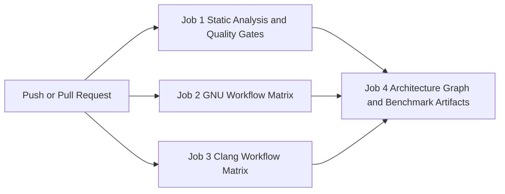

# GitHub Actions CI and CD analysis and implementation plan

This document analyzes how a free GitHub account executes automated build and test pipelines through GitHub Actions. It also defines a complete implementation plan for integrating the CMake presets of **Target Layout Extended** into a continuous integration workflow without modifying any existing project build logic.

---

## How GitHub Actions works on a free account

GitHub Actions is the built in continuous integration and continuous delivery platform provided directly inside every GitHub repository. You do not need external build servers or third party accounts to compile code and run tests automatically.

### Core concepts of GitHub Actions

* **Workflows.** A workflow is an automated pipeline defined by a YAML file inside the `.github/workflows/` directory of your repository. A repository can have one workflow file or multiple specialized workflow files.
* **Triggers.** Workflows run automatically in response to repository events. Common triggers include `push` to the `main` branch and `pull_request` changes targeting `main`. You can also enable `workflow_dispatch` for manual one click execution in the GitHub web interface.
* **Jobs.** A workflow consists of one or more jobs. By default, jobs run in parallel on separate virtual machines. You can also chain jobs sequentially so that expensive sanitizer jobs only start after a fast smoke build succeeds.
* **Runners.** Each job executes on a fresh virtual machine called a runner. GitHub provides pre configured Ubuntu Linux, Windows, and macOS virtual machines. Each machine boots cleanly for a single job and is destroyed immediately after the job finishes.
* **Steps and actions.** Inside a job, steps execute shell commands or reusable community plugins called actions. For a CMake presets project, steps are mostly single line `cmake --workflow --preset <Name>` shell invocations.

### Free tier quotas and hardware specifications

GitHub distinguishes between public repositories and private repositories on a personal free account.

| Resource or feature | Public repository on free account | Private repository on free account |
| :--- | :--- | :--- |
| **Monthly runner minutes** | Unlimited free minutes | 2000 free minutes per month |
| **Linux runner CPU and RAM** | 4 virtual CPUs and 16 GB RAM | 2 virtual CPUs and 7 GB RAM |
| **Linux runner disk space** | 14 GB fast SSD storage | 14 GB fast SSD storage |
| **Concurrent Linux jobs** | Up to 20 parallel jobs | Up to 20 parallel jobs |
| **Artifact and log storage** | Unlimited public log retention and 500 MB package storage | 500 MB shared artifact storage |
| **Dependency and build cache** | 10 GB free `actions/cache` storage per repository | 10 GB free `actions/cache` storage per repository |
| **Matrix builds and badges** | Included | Included |
| **Branch protection rules** | Included | Basic rules on free tier |

* **Public repositories are completely unrestricted.** If you publish **Target Layout Extended** as a public open source reference repository, GitHub grants unlimited build minutes and 4 core virtual machines at zero cost.
* **Private repositories consume minutes per job duration.** If a job runs for 2 minutes on Ubuntu, it deducts 2 minutes from the 2000 monthly allowance. A full matrix of 10 jobs taking 1 minute each consumes 10 minutes per push.

---

## Why CMakePresets.json makes GitHub Actions trivial

In traditional C++ repositories without `CMakePresets.json`, the CI YAML file becomes a fragile shell script filled with raw compiler flags and custom `ctest` arguments. When a build fails on GitHub, developers cannot easily reproduce the exact flags locally.

**Target Layout Extended** already encodes every compiler toolchain and sanitizer flag inside `CMakePresets.json` and `cmake/templates/target_compile_options.cmake`. Optimization profiles, debug levels, and static analyzers live in the same files. Because of this architecture, GitHub Actions does not need to know how the project is configured.

```bash
cmake --workflow --preset <WorkflowPresetName>
```

* **Zero configuration drift.** The exact command executed by the GitHub runner is identical to the command you run in your terminal on Fedora.
* **Declarative matrix expansion.** A single GitHub Actions job template can accept a `preset` variable and fan out into parallel virtual machines. Each machine tests one specific preset from `CMakePresets.json`.
* **Compiler and flag isolation.** Adding a new compiler flag or sanitizer adjustment only requires editing `cmake/templates/target_compile_options.cmake` once. The CI pipeline inherits the change automatically on the next commit.

---

## Environment analysis for Target Layout Extended

Running the exhaustive preset verification suite revealed four important environmental characteristics that directly shape how the GitHub Actions runner should be provisioned.

### Toolchain and package availability

**Target Layout Extended** uses C++23 features and modern compiler hardening flags alongside five external system dependencies discovered via `pkg-config`.

* **Compiler versions.** The project uses modern warnings and hardening macros like `-ftrivial-auto-var-init=pattern` and `_LIBCPP_HARDENING_MODE`. On Fedora 43, GCC 16 and Clang 22 are installed. On GitHub Actions `ubuntu-24.04` runners, GCC 14 and Clang 18 or Clang 19 are available from official packages. Alternatively, the job can run inside a `fedora:latest` container image to match your local workstation bit for bit.
* **System libraries via pkg-config.** Every required dependency has a direct system package on both Ubuntu and Fedora. Core build packages include `protobuf-compiler`, `libprotobuf-dev`, `libtbb-dev`, `libsystemd-dev`, `libgtest-dev`, `ninja-build`, and `ccache`. Static analysis and diagram packages include `clang-tidy`, `iwyu`, `cppcheck`, and `graphviz`.

### Fedora container versus bare Ubuntu runner

GitHub Actions natively supports running any job inside an OCI container image by adding a single `container: fedora:latest` line to the job definition.

| Approach | Advantages | Tradeoffs |
| :--- | :--- | :--- |
| **Fedora container on Ubuntu runner** | Matches your exact Fedora compiler versions and `libstdc++` headers alongside `include-what-you-use` mappings and `libgtest` packages. | Adds 15 to 25 seconds per job to pull the Fedora image and install `dnf` packages unless cached. |
| **Native Ubuntu 24.04 runner** | Starts immediately with pre installed CMake and Ninja alongside GCC and Clang. | Ubuntu splits `libgtest-dev` differently and uses older compiler versions that may differ in `include-what-you-use` internal header paths. |

Using a `fedora:latest` container image or testing both native Ubuntu and containerized Fedora gives you full confidence that your strict `-Werror`, `Clang_Tidy`, and `ENABLE_IWYU` rules work cleanly.

### Runtime behavior of Linux specific components in CI

Several components in **Target Layout Extended** interact directly with the Linux kernel and `systemd`. Their behavior inside a headless CI runner is already well aligned with the codebase design.

* **Journal component and systemd socket.** `targets/journal/journal.cpp` calls `sd_journal_send` via `libsystemd`. In a bare Ubuntu virtual machine, `systemd-journald` is running. Inside a minimal container where no `journald` socket exists, `sd_journal_send` returns `-ENOENT` safely without crashing or throwing exceptions. All `journalTEST` unit tests validate UUID catalog formatting and boundary exception catching in memory and pass in both environments.
* **Hardware performance counters in perf_scope.** Cloud virtual machines block hardware PMU counters by default or expose virtualized CPUs without hardware cycle counters. `targets/perf_scope/perf_scope.cpp` already implements graceful fallback when `perf_event_open` returns `-1`. It sets `pmu_available = false` and still measures wall clock latency accurately via `std::chrono::steady_clock`. This fallback allows `perf_scopeTEST` and `tbb_algosBENCH` to pass 100 percent of tests in cloud CI.
* **Deep STL debug mode and ABI boundary.** The `GNU_Custom_Debug_Deep` and `Clang_Custom_Debug_Deep` presets enable `-D_GLIBCXX_DEBUG`, which changes `std::vector` and `std::string` into `__gnu_debug::vector` and `__gnu_debug::basic_string`. These presets pass all 14 tests when linked against Fedora system packages. If a runner distribution compiles `libgtest` or `libprotobuf` with incompatible inline symbols, the Deep presets can be isolated into their own matrix leg.
* **Sanitizers with uninstrumented system shared libraries.**
  * **AddressSanitizer, UndefinedBehaviorSanitizer, and LeakSanitizer.** `GNU_UBSan_Verify` and `GNU_ASan_Verify` build and pass 100 percent of tests against standard system shared libraries. `Clang_UBSan_Verify`, `Clang_ASan_Verify`, and `Clang_LSan_Verify` also pass all 14 tests.
  * **ThreadSanitizer and oneTBB.** `Clang_TSan` compiles and links all 30 targets cleanly. At test runtime, ThreadSanitizer instruments the inline `parallel_for` headers inside `tbb_algos` while linking against the uninstrumented system `/lib64/libtbb.so.12`. Because ThreadSanitizer cannot see the internal task handoff barriers inside the prebuilt `libtbb.so.12` binary, it reports false positive data races on `tbb_algos` worker threads while passing all single threaded tests. In CI, `Clang_TSan` should either build all targets and run non TBB tests via `ctest --preset Clang_TSan_Test -E "TbbAlgos|tbb_algosBENCH"` or supply a `TSAN_OPTIONS` suppression file for `libtbb.so`.
  * **MemorySanitizer.** `Clang_MSan` requires an MSan instrumented `libc++` and `libgtest` at runtime to avoid uninitialized memory reports inside standard library internals. Setting `CMAKE_GTEST_DISCOVER_TESTS_DISCOVERY_MODE PRE_TEST` in `CMakeLists.txt` defers test execution to CTest runtime. Consequently, `cmake --build --preset Clang_MSan` compiles and links all 30 targets cleanly as a build verification gate.

---

## Complete preset inventory and CI mapping

Exhaustive testing of the repository confirmed the exact status of all configure, build, test, and workflow presets.

| Category | Presets | CI action | Verification status |
| :--- | :--- | :--- | :--- |
| **GNU standard and custom workflows** | `GNU_Default_Debug_Verify`, `GNU_Default_Release_Verify`, `GNU_Custom_Debug_Verify`, `GNU_Custom_Debug_Deep_Verify`, `GNU_Custom_Release_Verify` | Run full workflow for configure, build, and test | 5 of 5 workflows pass 14/14 tests |
| **GNU sanitizer workflows** | `GNU_UBSan_Verify`, `GNU_ASan_Verify` | Run full workflow for configure, build, and test | 2 of 2 workflows pass 14/14 tests |
| **Clang standard and custom workflows** | `Clang_Default_Debug_Verify`, `Clang_Default_Release_Verify`, `Clang_Custom_Debug_Verify`, `Clang_Custom_Debug_Deep_Verify`, `Clang_Custom_Release_Verify` | Run full workflow for configure, build, and test | 5 of 5 workflows pass 14/14 tests |
| **Clang sanitizer workflows** | `Clang_UBSan_Verify`, `Clang_ASan_Verify`, `Clang_LSan_Verify` | Run full workflow for configure, build, and test | 3 of 3 workflows pass 14/14 tests |
| **Clang TSan workflow** | `Clang_TSan` | Configure and build all 30 targets then run non TBB tests or apply TBB suppression | Builds 30/30 targets and passes all non TBB tests |
| **Clang MSan preset** | `Clang_MSan` | Configure and build all 30 targets via `cmake --build --preset Clang_MSan` | Builds 30/30 targets cleanly |
| **RelWithDebInfo presets** | `GNU_Default_RelWithDebInfo`, `GNU_Custom_RelWithDebInfo`, `Clang_Default_RelWithDebInfo`, `Clang_Custom_RelWithDebInfo` | Configure, build all 30 targets, and run `ctest` | 4 of 4 presets build 30/30 targets cleanly |
| **Static analysis preset** | `Clang_Tidy` | Configure and build via `cmake --build --preset Clang_Tidy` | Builds 17/17 library and app targets cleanly |
| **Optional CMake cache gates** | `ENABLE_WARNING_AS_ERROR=ON`, `ENABLE_IWYU=ON`, `ENABLE_CPPCHECK=ON`, `BUILD_TESTING=OFF`, `ENABLE_IPO=OFF` | Run as dedicated quality gate job steps | Pass with zero warnings or errors on both GCC and Clang |
| **Architecture artifact target** | `--target graphviz` | Build target and upload `project.dot` and `project.svg` as CI artifacts | Generates DOT and SVG cleanly |

---

## Proposed GitHub Actions architecture

To demonstrate how effortlessly the project integrates into CI and CD while keeping build times fast, the implementation plan organizes the pipeline into a single `.github/workflows/ci.yml` file with four logical job groups.



### Job 1 static analysis and strict compiler gates

This job validates code hygiene, physical include discipline, and zero warning compilation across both compilers.

* **Step 1.** Configure and build `Clang_Tidy` using `cmake --preset Clang_Tidy && cmake --build --preset Clang_Tidy`.
* **Step 2.** Configure and build `GNU_Custom_Debug` with `-DENABLE_WARNING_AS_ERROR=ON -DENABLE_CPPCHECK=ON`.
* **Step 3.** Configure and build `Clang_Custom_Debug` with `-DENABLE_WARNING_AS_ERROR=ON -DENABLE_IWYU=ON`.

### Job 2 GNU workflow matrix

This job uses GitHub Actions `strategy.matrix` to run every GNU workflow preset in parallel.

```yaml
strategy:
  fail-fast: false
  matrix:
    workflow:
      - GNU_Default_Debug_Verify
      - GNU_Default_Release_Verify
      - GNU_Custom_Debug_Verify
      - GNU_Custom_Debug_Deep_Verify
      - GNU_Custom_Release_Verify
      - GNU_UBSan_Verify
      - GNU_ASan_Verify
steps:
  - uses: actions/checkout@v4
  - name: Execute CMake workflow preset
    run: cmake --workflow --preset ${{ matrix.workflow }}
```

Look at the `run` command in that snippet. The entire build, link, and test execution for seven distinct GCC configurations is a single line of YAML. Setting `fail-fast: false` ensures that if one preset fails, all other matrix legs still run to completion so you see the full results table at once.

### Job 3 Clang workflow and sanitizer matrix

This job mirrors the GNU matrix for all Clang verification workflows.

```yaml
strategy:
  fail-fast: false
  matrix:
    workflow:
      - Clang_Default_Debug_Verify
      - Clang_Default_Release_Verify
      - Clang_Custom_Debug_Verify
      - Clang_Custom_Debug_Deep_Verify
      - Clang_Custom_Release_Verify
      - Clang_UBSan_Verify
      - Clang_ASan_Verify
      - Clang_LSan_Verify
steps:
  - uses: actions/checkout@v4
  - name: Execute CMake workflow preset
    run: cmake --workflow --preset ${{ matrix.workflow }}
```

A companion step or matrix entry also verifies `Clang_TSan`, `Clang_MSan`, and the `RelWithDebInfo` presets.

### Job 4 architecture diagram and benchmark report artifacts

GitHub Actions allows jobs to upload generated files as downloadable zip archives attached to the workflow run summary page via `actions/upload-artifact@v4`.

* **Architecture dependency graph.** Runs `cmake --build --preset GNU_Custom_Debug --target graphviz` and uploads `production_artifacts/graphviz/project.svg` and `production_artifacts/graphviz/project.dot`.
* **Component performance score report.** Uploads `production_artifacts/profiling/tbb_algos_score_report.md` generated during the `tbb_algosBENCH` test run.

---

## Finalized configuration and implementation summary

All five architectural decisions have been applied to the repository.

* **Fedora latest container environment.** Every job in `.github/workflows/ci.yml` runs inside `container: fedora:latest` so that `g++`, `clang++`, `clang-tidy`, `include-what-you-use`, and system packages match your local Fedora workstation bit for bit.
* **Public repository full matrix.** Because the repository is public and receives unlimited GitHub Actions minutes, all 16 verification workflows, static analysis gates, `RelWithDebInfo` presets, and `Clang_MSan` builds execute on every push and pull request targeting `main`.
* **Automated compiler caching.** `CMakeLists.txt` detects `ccache` via `find_program(CCACHE_PROGRAM ccache)` and sets `CMAKE_CXX_COMPILER_LAUNCHER`. Each CI job uses `hendrikmuhs/ccache-action@v1.2` keyed by preset name to cache object files across workflow runs.
* **ThreadSanitizer suppression for system oneTBB.** `tsan_suppressions.txt` suppresses false positive reports originating from uninstrumented system `libtbb.so` and `libtbbmalloc.so` binaries alongside inline `tbb::detail::` task handoffs. `Clang_TSan_Test` passes `TSAN_OPTIONS` automatically so `Clang_TSan_Verify` runs and passes all 14 tests in the Clang CI matrix.
* **Live status badge and branch protection.** `README.md` now displays a live status badge linked to `.github/workflows/ci.yml`. Once the first workflow run completes on GitHub, enable branch protection under **Settings > Branches > Add branch ruleset** for `main`, check **Require status checks to pass**, and select the CI matrix jobs.

---

## Integrating a Gemini agent to automatically examine CI results

You can integrate an autonomous Gemini agent directly into GitHub Actions so that it inspects build logs, sanitizer stack traces, static analysis warnings, and benchmark score reports on every run.

### Official Google GitHub Action with `run-gemini-cli`

Google provides the official `google-github-actions/run-gemini-cli` action, which runs the headless Gemini CLI agent inside a GitHub Actions runner with full access to your repository files, build artifacts, and the GitHub CLI.

1. **Create a Gemini API key.** Generate a free or paid API key in Google AI Studio.
2. **Store the secret in GitHub.** Open your repository on GitHub and navigate to **Settings > Secrets and variables > Actions**. Create a new repository secret named `GEMINI_API_KEY`.
3. **Add an examination job to your workflow.** Add a dependent job that runs with `if: always()` after the build matrices finish. It downloads the logs or benchmark artifacts and invokes `google-github-actions/run-gemini-cli@v1` to post a summary to the GitHub Actions run page or pull request comments.

```yaml
  gemini-ci-examiner:
    name: Gemini CI Result Examiner
    needs: [static-analysis, gnu-matrix, clang-matrix, extra-presets-and-artifacts]
    if: always()
    runs-on: ubuntu-24.04
    permissions:
      contents: read
      actions: read
      issues: write
      pull-requests: write
    steps:
      - name: Checkout repository
        uses: actions/checkout@v4

      - name: Download benchmark and architecture artifacts
        uses: actions/download-artifact@v4
        with:
          name: architecture-and-benchmark-artifacts
          path: ci_artifacts
        continue-on-error: true

      - name: Fetch failed job logs via GitHub CLI
        env:
          GH_TOKEN: ${{ secrets.GITHUB_TOKEN }}
        run: |
          gh run view ${{ github.run_id }} --log-failed > failed_ci_logs.txt || true

      - name: Examine CI results with Gemini Agent
        uses: google-github-actions/run-gemini-cli@v1
        with:
          gemini-api-key: ${{ secrets.GEMINI_API_KEY }}
          prompt: |
            Examine the CI results for this workflow run.
            1. Read failed_ci_logs.txt. If any compiler, clang-tidy, IWYU, or sanitizer job failed, identify the exact component target, file, line number, and root cause, and propose a minimal C++23 fix.
            2. Read ci_artifacts/tbb_algos_score_report.md if present and summarize the latency, IPC, achieved score, and diminishing-returns decision.
            3. Write a concise markdown report to $GITHUB_STEP_SUMMARY.
```

### Three practical patterns for Gemini in GitHub Actions

* **Automated failure root cause analysis.** By running `gh run view ${{ github.run_id }} --log-failed > failed_ci_logs.txt` before invoking Gemini, the agent only reads failed step logs instead of parsing megabytes of passing output. Because the agent also has read access to the checked out repository, it can cross reference a sanitizer trace or an `include-what-you-use` error against the exact header in `targets/` and write the fix directly into `$GITHUB_STEP_SUMMARY`.
* **Automated benchmark score evaluation.** Because **Target Layout Extended** produces structured markdown in `tbb_algos_score_report.md` and `baseline.json`, the Gemini agent can compare the CI run against the birth baseline and post a pull request comment explaining whether an optimization improved instructions per cycle or hit diminishing returns.
* **Interactive pull request assistant.** If you also trigger `run-gemini-cli` on `issue_comment` events, you can comment `@gemini-cli why did Clang_Custom_Debug_Deep fail?` on any pull request and the agent will inspect the workflow logs and reply on the thread.

